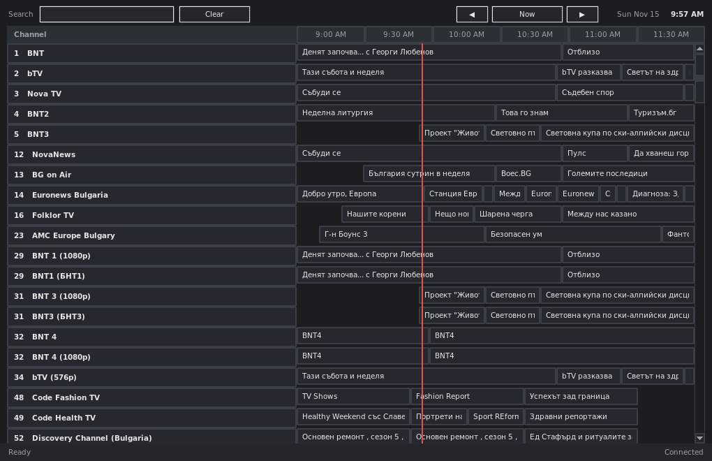
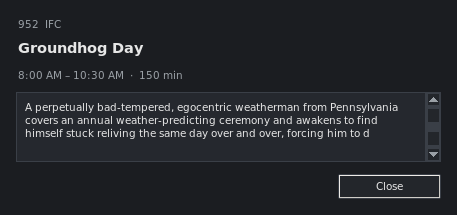
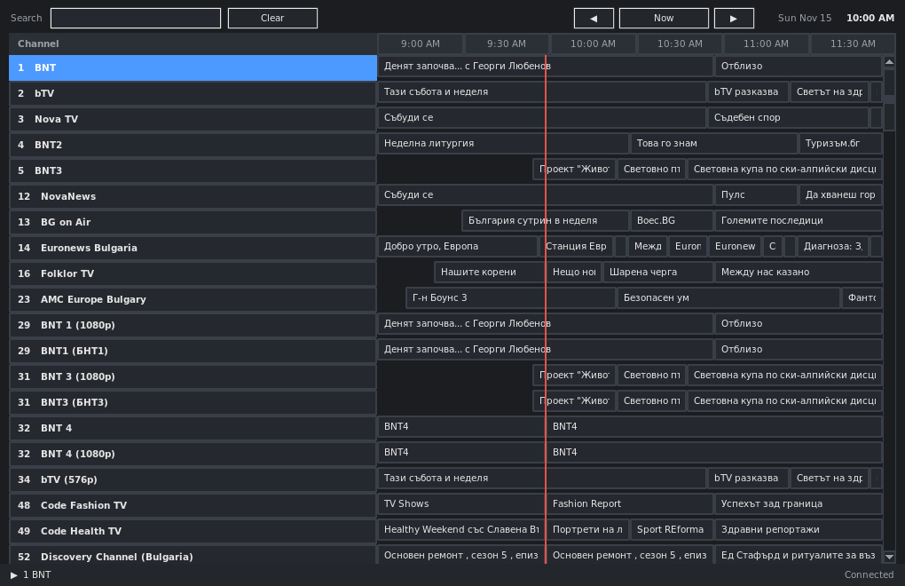

# tvhc — a TVHeadend client

`tvhc` is a small desktop application for watching live TV from a
[TVHeadend](https://tvheadend.org/) server. It shows the program guide in a
scrollable grid and starts [mpv](https://mpv.io/) to play whichever channel
you pick.



It is a single Python file (`tvhc.py`) using Tkinter, the `requests` library,
and `mpv`. There is nothing to build.

## Requirements

- **Python 3.13 or newer** (the configuration file uses
  `configparser`'s unnamed-section support, added in 3.13)
- **tkInter** — usually packaged separately from Python
- **[requests](https://github.com/psf/requests)**
- **[mpv](https://mpv.io/)** — installed and on your `PATH`

Install them with your system package manager, for example:

```sh
# Debian / Ubuntu
sudo apt install python3 python3-tk python3-requests mpv

# Fedora
sudo dnf install python3 python3-tkinter python3-requests mpv

# Arch Linux
sudo pacman -S python tk python-requests mpv
```

## Install and run

There is no build step and no installation. Clone the repository and run the
script:

```sh
git clone https://github.com/GrantEdwards/tvhc.git
cd tvhc
python3 tvhc.py
```

You can also put `tvhc.py` somewhere in your `PATH` (or make a symlink) and
run `tvhc.py` directly, as long as it is executable.

## Configuration

Configuration is read from `~/.tvhc.ini`:

```ini
Server = 192.168.1.45:9981
Username = username
Password = password
UseTLS = no
Auth = Digest
```

All fields except `Server` are optional.

- `Server` is the host and port of the **TVHeadend web interface**. The
  default web port is `9981`. Do not use `9982` — that is the HTSP protocol
  port, not the web interface.
- `UseTLS = yes` uses `https://` instead of `http://`. Self-signed
  certificates are not accepted.
- `Auth` may be `None`, `Plain`, `Basic`, or `Digest`. `Plain` and `Basic`
  are the same thing. If no username or password is configured, `Auth`
  defaults to `None`; otherwise it defaults to `Digest`.

If your server uses different authentication for the API than the default,
set `Auth` explicitly. For example, some servers only advertise Basic
authentication, in which case `Auth = Basic` is required.

You can bypass the configuration file by passing a full server URL as the
first argument:

```sh
python3 tvhc.py http://192.168.1.45:9981/
```

## Using tvhc

| Action | How |
| --- | --- |
| Play a channel | Click its name, or click any program in its row |
| Stop playback | Click the playing channel again (mpv stays open, idle) |
| Program details | Right-click a program |
| Select a channel | <kbd>↑</kbd> / <kbd>↓</kbd> |
| Play/stop selected channel | <kbd>Enter</kbd> |
| Scroll the guide | Mouse wheel, scrollbar, or <kbd>PgUp</kbd> / <kbd>PgDn</kbd> |
| Move the guide back / forward | <kbd>◀</kbd> / <kbd>▶</kbd> buttons or <kbd>←</kbd> / <kbd>→</kbd> (30 minutes at a time) |
| Return to the current time | **Now** button |
| Filter channels | Type a channel number or name in **Search** |
| Show only channels with program data | Tick **Only channels with EPG** |
| Clear the filter | <kbd>Esc</kbd> or **Clear** |
| Close program details | **Close** or <kbd>Esc</kbd> |

A red line marks the current time. The status bar at the bottom shows what is
playing and whether the server is reachable. The current-time marker updates
every minute, and the guide reloads automatically as time passes; if the
server cannot be reached, it retries every minute.





The playing channel is highlighted and the status bar shows what is playing.
`mpv` opens once in its own window and switches channels in place; it closes
when you quit tvhc.

## Program guide

The grid shows the next three hours of programming for every channel, in
half-hour slots starting half an hour before the current time. Clicking any
program in a row plays that channel live — it does not play a recording.

By default every channel on the server is listed, including channels that
have no EPG data. Those rows show **No program data** and can still be played
by clicking them. Tick **Only channels with EPG** to hide channels that have
no programs in the visible time window.

While you are on the current time window the guide advances automatically. If
you move it with <kbd>◀</kbd> / <kbd>▶</kbd>, it stays where you put it until
you press **Now**.

## Troubleshooting

- **401 Unauthorized** — check `Username` and `Password`, then try
  `Auth = Basic` or `Auth = Digest` explicitly.
- **Connection refused, timeout, or "empty reply from server"** — the wrong
  port is the usual cause. Use the web interface port (`9981` by default),
  not the HTSP port (`9982`).
- **The window opens but the guide is empty** — check the message in the
  status bar. The server may have no EPG data yet, or the API request may be
  failing. It retries every minute.
- **"mpv: not found" or nothing plays** — make sure `mpv` is installed and on
  your `PATH`; run `mpv --version` in a terminal to check.
- **TLS errors** — `UseTLS = yes` requires a certificate that `requests`
  trusts. On a home LAN, plain `http` is usually simpler.

## License

GNU General Public License v3.0. See [LICENSE](LICENSE).
